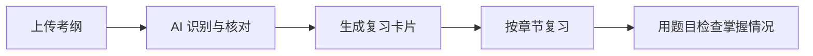

<div align="center">

# Revision Studio

### 把考纲变成能真正用起来的复习卡片

内置 IGCSE Computer Science 0478；也可以上传自己的考纲，让 AI 整理重点、生成笔记，并把试题解析和知识点连起来。

[](#内置复习)
[](#立刻体验)
[](#使用-ai)
[](#你的学习记录)

[立刻体验](#立刻体验) · [使用 AI](#使用-ai) · [导入考纲](#导入自己的考纲) · [解析题目](#解析一道题) · [遇到问题](#遇到问题)

</div>

---

## 一眼看懂

| 复习 | 生成 | 解析 |
|---|---|---|
| 按章节浏览考纲卡片，标记复习进度 | 上传考试大纲，AI 提取考点并生成重点与图示 | 上传题目和评分标准，查看答案、步骤和关联知识点 |



## 内置复习

内置 Cambridge IGCSE Computer Science 0478，共 10 个主题、24 个章节和 102 个考点。

## 立刻体验

即使没有 API Key，也可以先使用内置资料。

1. 在 GitHub 页面点击 **Code → Download ZIP**，下载后解压。
2. 打开 `Review-studio` 文件夹。
3. 双击 `revision-studio.html`。

页面打开后，左侧已经列好科目和章节，可以直接开始复习。

> [!TIP]
> 内置资料可以离线复习。公式显示和 PDF 读取需要联网加载组件。

## 使用 AI

AI 功能需要一个 DeepSeek API Key，并会产生少量接口费用。没有 Key 不影响内置复习。

### 1. 准备 API Key

前往 [DeepSeek 开放平台](https://platform.deepseek.com/) 注册并创建 API Key。

> [!IMPORTANT]
> API Key 相当于账户凭证。不要发给别人，也不要上传到 GitHub。建议直接在网页里填写，不必写进任何文件。

### 2. 启动本地页面

在文件资源管理器中打开 `Review-studio` 文件夹，点击顶部地址栏并输入 `powershell`，按回车。随后输入：

```powershell
python -B serve.py
```

看到以下地址后，浏览器通常会自行打开：

```text
http://localhost:8787/revision-studio.html
```

如果没有自动打开，复制上面的地址到 Chrome 或 Edge。

<details>
<summary><b>提示：系统找不到 python 命令</b></summary>

请安装 [Python 3](https://www.python.org/downloads/)，安装时勾选 **Add Python to PATH**，然后重新打开 PowerShell。

也可以尝试：

```powershell
py -B serve.py
```

macOS 或 Linux 通常使用：

```bash
python3 -B serve.py
```

</details>

### 3. 在网页中连接 AI

1. 点击“导入考纲”，展开“接口与模型”。
2. 接口选择 **本地代理**。
3. 模型填写 `deepseek-flash`。
4. 粘贴 API Key。
5. 点击“测试连接”。

连接成功后，就可以开始导入自己的考纲。

> [!NOTE]
> 使用结束后，在运行 `serve.py` 的窗口按 `Ctrl+C` 即可停止本地页面服务。

## 导入自己的考纲

1. 点击左侧的 **导入考纲**。
2. 输入科目名称，或留空让 AI 自动识别。
3. 上传 PDF、TXT、Markdown，或直接粘贴考纲文字。
4. 如果知道正文页码，可以填写页码范围，减少费用和等待时间。
5. 点击“开始识别”，检查提取出的章节和考点数量。
6. 确认内容后开始生成卡片，完成后按知识点逐条复习。

AI 只负责定位和整理；卡片会保留考纲原文，重要词也会在原文中标出。

> [!TIP]
> PDF 必须是带文字层的电子版。拍照或扫描出来的 PDF 没有可选文字，请改为直接粘贴考纲内容。

## 解析一道题

1. 点击左侧的 **导入题目**。
2. 上传题目截图或 PDF。
3. 有评分标准时一起上传；没有也可以独立解析。
4. 检查题号、公式和答案是否配对正确。
5. 开始解析，然后逐题查看答案、步骤、得分点和关联知识点。

解析可以中断并继续。关联考纲后，右侧的知识点可以直接跳回对应复习卡片。

## 你的学习记录

学习记录保存在当前浏览器中，项目没有额外的云端数据库。使用 AI 时，相关考纲、题目和必要上下文会发送到你选择的模型接口。

> [!WARNING]
> 你的科目和历史题目与“浏览器 + 页面地址”绑定。换浏览器、换端口或清除网站数据后，旧记录可能不再显示。

建议每次学习结束后：

1. 点击页面左下角“更多”。
2. 选择 **备份全部**。
3. 将备份文件保存到云盘或其他安全位置。

备份不包含 API Key。题目原图单独保存在浏览器中，重要原题也应自己保留一份。

## 遇到问题

| 看到的问题 | 处理办法 |
|---|---|
| `401` | API Key 不正确，重新复制或重新创建 |
| `402` | DeepSeek 账户余额不足 |
| `429` | 请求太频繁，等一会儿再试 |
| `Failed to fetch` | 优先使用“本地代理”；确认 `serve.py` 仍在运行 |
| PDF 没有识别到文字 | 文件可能是扫描件，改用截图或粘贴文本 |
| 以前的科目不见了 | 检查是否换了浏览器、端口或文件地址，尝试恢复备份 |
| 端口 8787 被占用 | 关闭占用端口的程序；更换端口前先备份全部资料 |

## 使用边界

- AI 生成的笔记、答案和知识点关联可能出错，重要内容请对照官方考纲和评分标准。
- AI 补全的考点会显示提示，不应替代官方文件。
- 公式渲染依赖 KaTeX；PDF 读取依赖 PDF.js，这两项需要联网。
- 当前版本没有扫描件 OCR。
- 自动构建与测试工具已移除，网页运行时不需要它们。

<details>
<summary><b>开发与维护说明</b></summary>

`Review-studio/revision-studio.html` 是实际运行入口，已包含样式、脚本和内置资料。`serve.py` 只负责本机页面服务、模型请求代理和响应缓存。

`Review-studio/src/` 是源码快照，不参与网页运行。修改这个目录不会自动更新最终网页；如确需从源码重建，应以 Git 历史中的清理前版本为准。

详细修改边界与验证要求见 [`Review-studio/AGENTS.md`](Review-studio/AGENTS.md)。

</details>

---

<div align="center">

**Built for focused revision, not busywork.**

如果这个项目对你有帮助，欢迎留下一个 Star。

</div>
